# Endpoint Patch Management | Action1 Security & Automation Lab

[](https://www.action1.com/)


**Project type:** Personal cybersecurity home lab  
**Platform:** Action1 cloud endpoint and patch management  

## Project overview

This project documents an endpoint patch-management workflow performed through **Action1** in a controlled home lab. It covers the process of registering endpoints, reviewing the vulnerability and missing-update inventory, prioritizing security patches, configuring deployment automation, assessing the results, enrolling a Kali Linux endpoint, and testing software distribution.

The emphasis is on **the operational workflow**: discover → prioritize → deploy → monitor → reassess → document outstanding risk. Unlike a generic Action1 tutorial, the results below are tied to the actual screenshots captured during the lab.

### Demonstrated outcomes

- A **Windows 11 (26H2)** workstation, labeled `L3X`, appeared as a connected managed endpoint in Action1.
- Four updates categorized by Action1 as **Critical** were selected: Google Chrome, Microsoft .NET Runtime 8, and Windows Desktop Runtime 8 and 10.
- Action1 reported that the four-update automation on `L3X` completed with **Status: Success** on **November 16, 2026, at 5:27 PM**.
- Subsequent dashboards and reports were reviewed for unresolved updates and vulnerabilities; these are separate point-in-time observations, **not** a controlled before/after proof that every reported issue was fixed by that one automation.
- A Kali Linux agent was installed/enrolled and later appeared as a **Connected** endpoint alongside Windows.
- A 1Password software deployment was configured for Windows; the final automation screenshot reports **Running**, not a confirmed completed task.

> **Evidence and scope:** Every image in this repository comes from the original home-lab document. The screenshots show platform-reported findings and workflow states; they are not an independent exploit validation or a complete patch-compliance audit. See `SCREENSHOT-GUIDE.md` for the original-to-renamed image mapping.

## Objectives

1. Obtain visibility of enrolled Windows and Linux endpoints through a centralized management console.
2. Identify missing updates and prioritize high-severity patch opportunities.
3. Build and execute an automated deployment for the selected critical updates.
4. Review automation history and post-deployment inventory for remaining risk.
5. Examine remediation options for vulnerabilities with no direct software update.
6. Extend coverage to a Kali Linux VM by installing the Action1 agent.
7. Evaluate controlled software deployment through the Action1 application catalog.

## Skills demonstrated

Endpoint inventory • Windows patch management • Vulnerability triage • Automation scheduling • Deployment status validation • Linux agent onboarding • Software distribution • Residual-risk assessment • Technical evidence reporting

## Lab environment

| Component | Role | Evidence |
| --- | --- | --- |
| Action1 cloud console | Centralized endpoint inventory, update catalog, vulnerability view, deployment and automation history | Screenshots 131–143 and 145–150 |
| Windows 11 (26H2), `L3X` | Managed endpoint used for update and software deployment workflows | Connected in screenshots 132, 138, 141, 143, 146 |
| Kali Linux virtual machine | Linux endpoint enrolled with the Action1 `.deb` installer | Installation screenshots 144–145; Connected in screenshot 146 |
| Oracle VirtualBox | Hypervisor visibly running Kali Linux | Screenshot 145 |
| 1Password | Example software package used to demonstrate application deployment | Screenshots 147–151 |

### Logical monitoring topology

```text
Action1 cloud management console
           |
           |  Endpoint inventory / update and automation policy
           |
     Action1 agents
           |
           +-----------------------------+
           |                             |
  Windows 11 workstation           Kali Linux VM
  Host: L3X                        Oracle VirtualBox
  Windows updates +               Linux agent enrollment
  application deployment          and agent visibility
```

This is a **management relationship diagram**, not a verified physical subnet diagram. The screenshots do not document a specific common LAN address range for both devices.

---

## Implementation and evidence

### 1. Review the patch-management platform

The workflow started with Action1's management platform. This provided the centralized interface for endpoint visibility, software updates, vulnerabilities, and automation.

**Why this matters:** A centralized endpoint inventory makes it easier to locate unpatched systems and deploy approved software changes consistently instead of updating each machine manually.

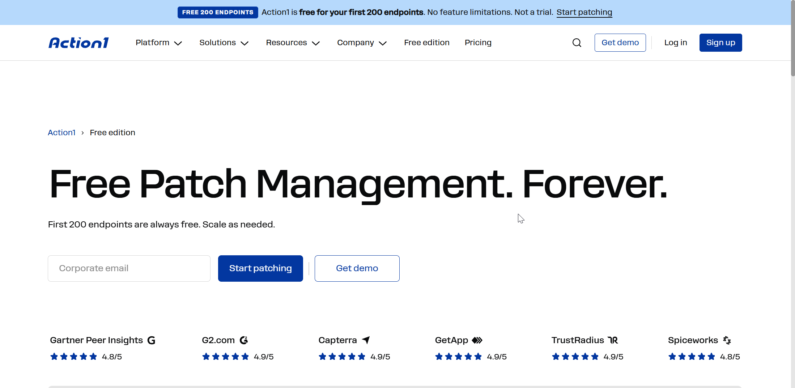

*Figure 1. Action1 platform orientation. This is a public product page, not a dashboard deployment result.. Source screenshot: `image131.png` from the original lab document.*

### 2. Confirm Windows endpoint enrollment and review baseline posture

From **Endpoints**, I filtered the console to the `L3X` workstation. The initial screenshot reported the host as **Connected**, **Windows 11 (26H2)**, with no reboot required.

| Category | Initial Action1 snapshot |
| --- | ---: |
| Critical vulnerability records | **86** |
| Non-critical vulnerability records | **769** |
| Critical missing updates | **4** |
| Non-critical missing updates | **17** |

**How to interpret the numbers:** Action1 distinguishes vulnerability records from missing updates. One update can address multiple vulnerability records, so these numbers should not be combined or interpreted as independent machines or confirmed exploitable CVEs. They also depend on the date, filters and scan state.

The lower portion of the screenshot opened the endpoint-specific **Missing Updates** panel, providing the information needed to select a patch batch.

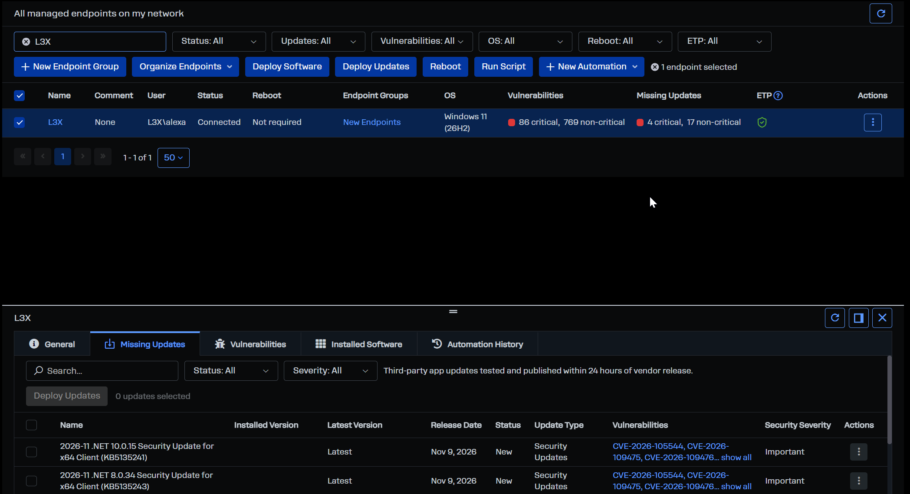

*Figure 2. Windows 11 endpoint inventory and initial missing-update and vulnerability counts.. Source screenshot: `image132.png` from the original lab document.*

### 3. Identify and prioritize the four Critical updates

On the endpoint's **Missing Updates** tab, I applied the **Severity: Critical** filter and selected all four available updates. The screenshot records these installed and target versions:

| Software | Installed version shown | Action1 target version shown | Update category |
| --- | --- | --- | --- |
| Google Chrome | `157.0.8103.78` | `157.0.8103.79` | Security Updates |
| Microsoft .NET Runtime 8 | `8.0.21.35325` | `8.0.34.36622` | Security Updates |
| Microsoft Windows Desktop Runtime 10 | `10.0.13.50000` | `10.0.15.50000` | Security Updates |
| Microsoft Windows Desktop Runtime 8 | `8.0.22.35428` | `8.0.34.36622` | Security Updates |

Action1 classified all four entries as **Critical**. The Chrome row also displayed references to multiple 2026 CVEs. Those CVE labels are **platform-reported metadata**; this project does not claim independent exploitation or validation of individual Chrome vulnerabilities.

**Why the selection matters:** Prioritizing critical security updates first is a practical risk-reduction strategy. The next step is to create a deployment and monitor the outcome, rather than assuming that selecting an update means it was installed.

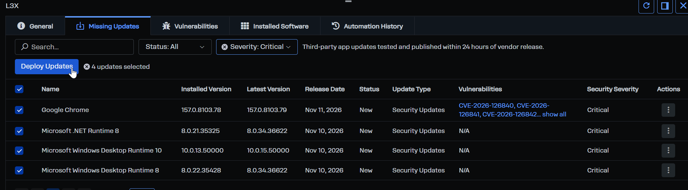

*Figure 3. Critical-update filter showing the four selected packages and target versions.. Source screenshot: `image133.png` from the original lab document.*

### 4. Configure the update deployment

I opened **Deploy Updates** and reviewed the selected patch set before scheduling. Action1's three-step wizard organizes the activity into **Deploy Updates → Select Endpoints → Schedule**.

The deployment-configuration screen shows:

- Four selected updates matching the security triage above.
- **Reboot options** displayed with automatic behavior and a four-hour message timeout.
- **Deactivate updates in Windows settings** checked to allow the Action1-managed workflow to control patch installation windows.
- A notice about optional peer-to-peer distribution efficiency when agents share a LAN.

**Operational consideration:** Taking over Windows Update behavior may be appropriate in an explicitly managed environment, but should be governed by an approved patch policy. In a business environment, reboot behavior, maintenance windows, dependencies, backups and user impact should be reviewed before scheduling.

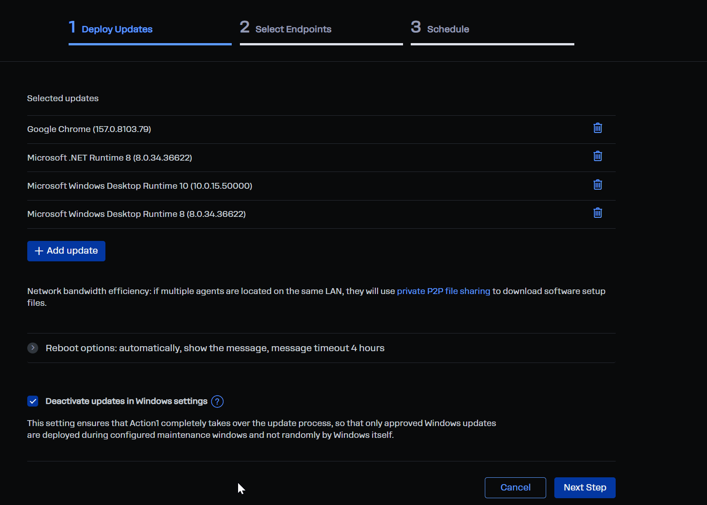

*Figure 4. Four-package deployment setup, reboot controls and Windows Update management option.. Source screenshot: `image134.png` from the original lab document.*

### 5. Configure the automation schedule

The final wizard stage presented scheduling options, including **Run once**, **Run now**, **At specified time**, and recurrence choices, plus retry/maintenance-window settings. The selected run schedule is visible in the source screenshot.

**What scheduling accomplishes:** It converts an update-selection exercise into a trackable automation. A scheduled job has an execution state and history, allowing the operator to distinguish *configured*, *running*, and *finished* deployments.

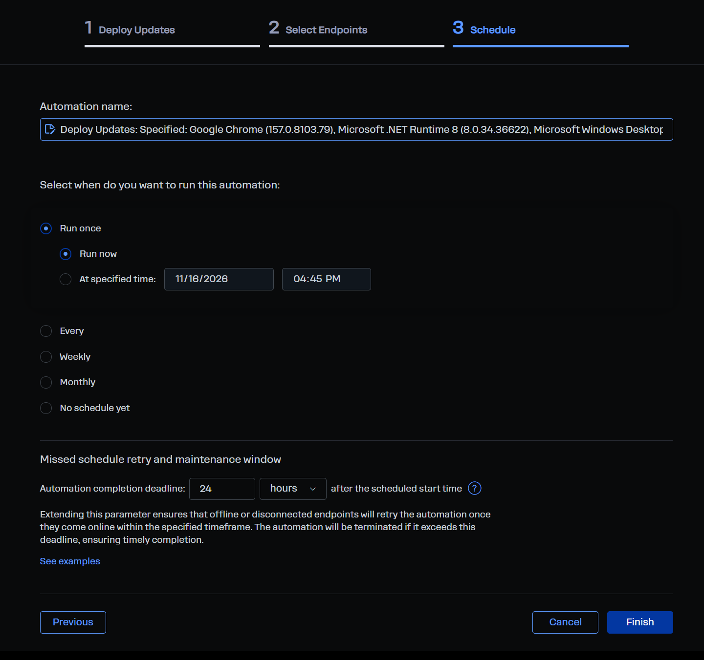

*Figure 5. Deployment automation schedule and maintenance-window settings.. Source screenshot: `image135.png` from the original lab document.*

### 6. Monitor automation execution

I reviewed the new deployment in the **Automation History / details** view. The first captured state reads **Running**, with the message that Action1 was waiting for the endpoint to run the automation.

This is important evidence of job creation, but a **Running** state alone is not evidence that patches have been installed.

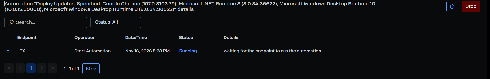

*Figure 6. Update deployment automation in the Running state.. Source screenshot: `image136.png` from the original lab document.*

### 7. Verify the completed update automation

The next record is the clearest execution outcome in the project:

| Field | Value shown |
| --- | --- |
| Endpoint | `L3X` |
| Automation | Deploy Updates: four specified packages |
| Operation | **Completed** |
| Status | **Success** |
| Date/time | **Nov 16, 2026, 5:27 PM** |
| Detail | "The action completed successfully." |

This confirms that **Action1 reported successful completion of the automation**. It does **not**, on its own, provide per-package installer logs, a rollback test, or proof of complete elimination of every associated CVE. Those would require additional verification.

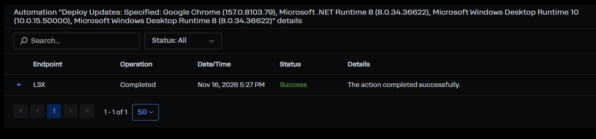

*Figure 7. Action1 automation history showing Completed / Success for the four selected updates.. Source screenshot: `image137.png` from the original lab document.*

### 8. Review the follow-up Windows posture

After the completed deployment, another inventory screenshot shows a changed endpoint state:

| Metric | Follow-up snapshot |
| --- | ---: |
| Critical vulnerability records | **85** |
| Non-critical vulnerability records | **755** |
| Critical missing updates in the filtered panel | **No entries** |
| Non-critical missing updates in endpoint summary | **15** |

The **Critical** missing-updates filter showed **No entries** at that point. This is useful follow-up evidence, but the lower counts cannot be attributed solely to the four-update job without consistent timestamps, inventory refresh records and per-patch verification.

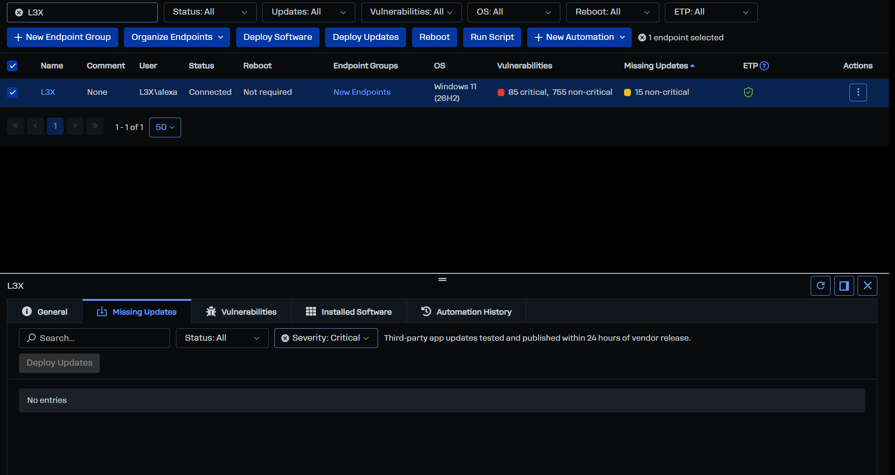

*Figure 8. Follow-up Windows inventory with the Critical missing-updates filter showing no entries.. Source screenshot: `image138.png` from the original lab document.*

### 9. Investigate remaining non-critical update backlog

I then removed the Critical-only focus and viewed the remaining list of software and driver updates. Action1 reported **15 updates selected/visible** in one screenshot, including applications, vendor drivers and utilities such as 7-Zip, Ghostscript, and device-related packages.

**Analyst approach:** Non-critical does not mean irrelevant. The next triage should consider whether the software is exposed to untrusted files, whether the update fixes a security issue, operational dependencies and the amount of business disruption involved.

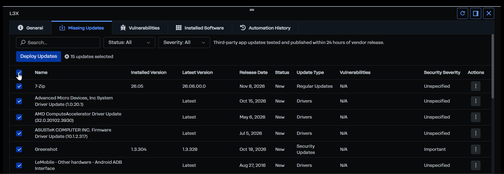

*Figure 9. Non-critical missing updates remaining after the critical deployment.. Source screenshot: `image139.png` from the original lab document.*

### 10. Prepare an additional update batch

A later **Selected updates** screen showed a wider set of software, firmware, driver, utility, runtime and application packages, including .NET components, Visual C++ Redistributable, Wireshark, WinRAR, and Zoom.

This screenshot documents **selection and planning** for a subsequent patch batch. It does not independently show that the entire additional batch was executed successfully; the completed job evidence is specifically the four-update automation above.

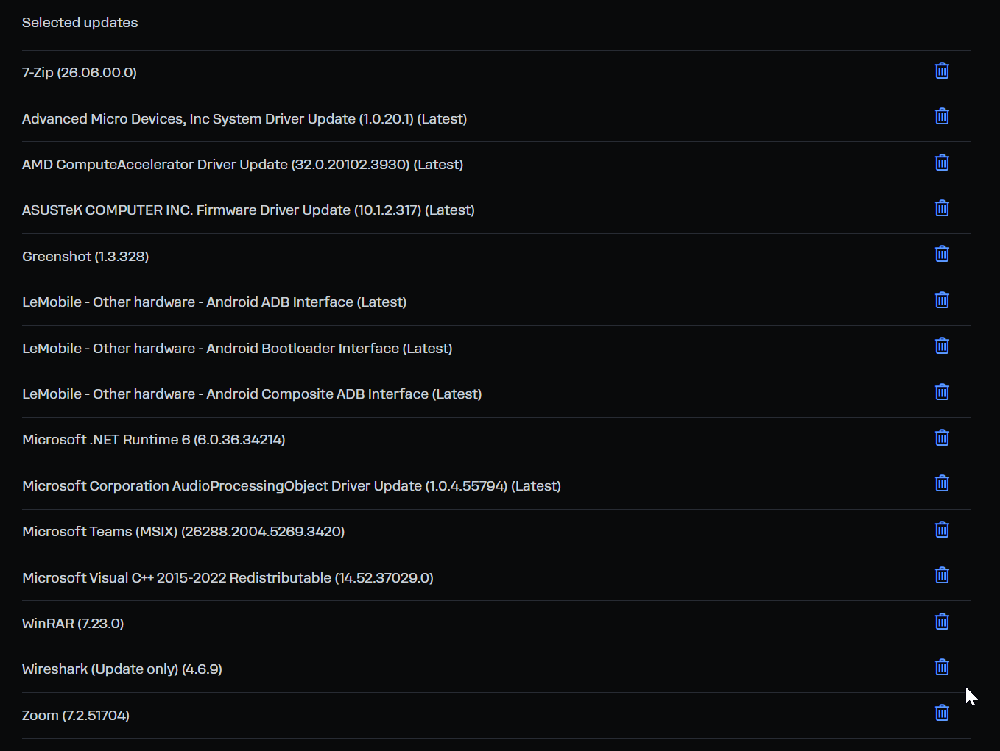

*Figure 10. Additional software and driver packages selected for a later deployment.. Source screenshot: `image140.png` from the original lab document.*

### 11. Review additional inventory snapshots carefully

A later endpoint inventory screen shows **107 non-critical vulnerability records** and **10 non-critical missing updates**. The absence of Critical counts in that particular view should not be used as a precise treatment-effect measurement without confirming filters and refresh times.

**Why the numbers can change:** Counts may move because of scan refreshes, updated vulnerability catalogs, installed-software changes and filters. A good vulnerability-management report preserves the dates and evaluation context rather than claiming that every difference was caused by one action.

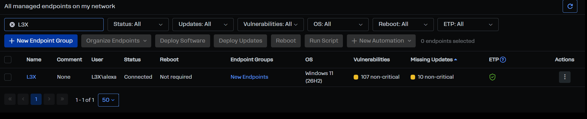

*Figure 11. Subsequent endpoint snapshot showing non-critical-only counts.. Source screenshot: `image141.png` from the original lab document.*

### 12. Assess vulnerabilities that do not have an automated patch

The **Select remediation actions for each vulnerability** window lists entries such as Microsoft Visual C++ Redistributable and Opera GX Stable. Some entries show **Update Available: N/A** and offer **Document compensating controls** as a possible remediation action.

In a real patch process, each such finding should be evaluated individually:

| If an update is... | Example analyst action | Verification |
| --- | --- | --- |
| Available and tested | Schedule software update | Re-scan plus package-version check |
| Not available | Restrict exposure, disable feature, or remove app where feasible | Verify control and record risk owner |
| Not relevant or false positive | Collect supporting version / configuration evidence | Document rationale and revisit on new intel |
| Deferred for compatibility | Record exception, expiry and compensating control | Periodic review and monitoring |

The screenshot establishes that Action1 **presented these remediation options**, not that the controls were actually deployed.

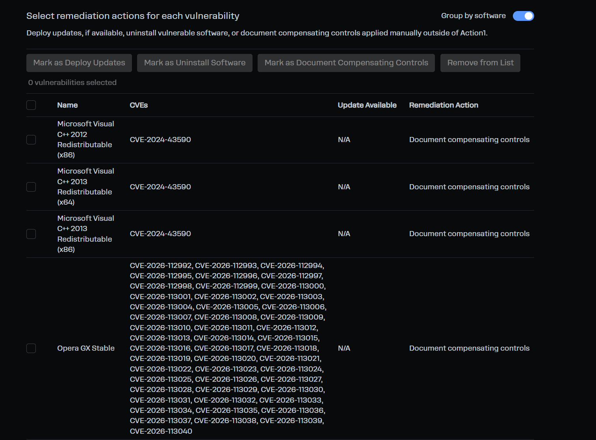

*Figure 12. Action1 vulnerability-remediation screen with compensating-control options for findings with no listed update.. Source screenshot: `image142.png` from the original lab document.*

### 13. Check the later reduced-finding snapshot

Another later screenshot shows `L3X` connected, with **1 non-critical vulnerability** and **1 non-critical missing update** reported. This indicates a later lower-count inventory state, but the source does not contain complete historical logs tying that change to a specific individual remediation action.

**Reporting principle:** Treat each dashboard as a snapshot. For a production patch-compliance claim, export endpoint and vulnerability reports at consistent times, associate them with deployment job IDs, and compare verified software versions.

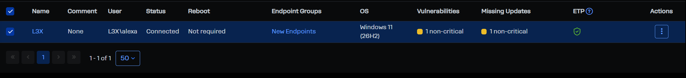

*Figure 13. Later inventory displaying one non-critical vulnerability and one non-critical missing update.. Source screenshot: `image143.png` from the original lab document.*

### 14. Prepare the Action1 Linux agent installation on Kali

To extend endpoint visibility beyond Windows, I moved to a **Kali Linux** VM. The terminal screenshot shows an Action1 `.deb` package copied into `/tmp` and an installation started using `apt`.

The command sequence visible in the terminal is summarized below:

```bash
# Copy the downloaded agent package to a temporary directory
cp action1_agent.deb /tmp

# Change to that directory
cd /tmp

# Install the local Debian-format package
sudo apt install ./action1_agent.deb
```

**Command explanation**

| Command / part | Purpose |
| --- | --- |
| `cp action1_agent.deb /tmp` | Copies the downloaded Debian package into `/tmp` |
| `cd /tmp` | Changes the terminal's working directory |
| `sudo` | Runs the installer with administrative privileges |
| `apt install` | Invokes the Debian/Ubuntu package-management installer |
| `./action1_agent.deb` | Refers to the local package file in the current directory; `./` distinguishes it from a repository package name |

The screenshot shows installer output, but the most reliable enrollment result is the later Action1 console screenshot in Step 16, where Kali is shown as **Connected**.

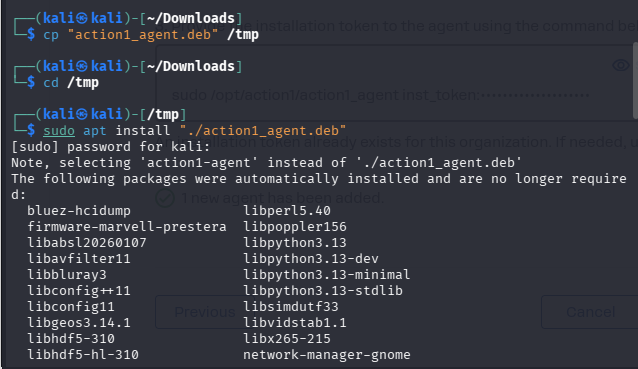

*Figure 14. Kali terminal showing copying and installing the Action1 Debian agent package.. Source screenshot: `image144.png` from the original lab document.*

### 15. Enroll the Linux agent in the Action1 organization

The Action1 **Install Agent** wizard provides installation options and a downloadable `.deb` package. It also displays a command for supplying an organization-specific installation token to the agent:

```bash
# Template only: supply a fresh enrollment token from your own Action1 console
sudo /opt/action1/action1_agent inst_token:<YOUR_ENROLLMENT_TOKEN>
```

The source screenshot shows the token as masked; **no real enrollment token is included in this repository**. Enrollment tokens should be handled as credentials and never committed to a public Git repository. The screenshot also displays a confirmation that one new agent was added.

> **Note:** This is a reproduction of the wizard's instruction pattern, not proof that a particular terminal command with the original token was executed. Verify syntax against the current Action1 Linux-agent instructions when repeating the lab.

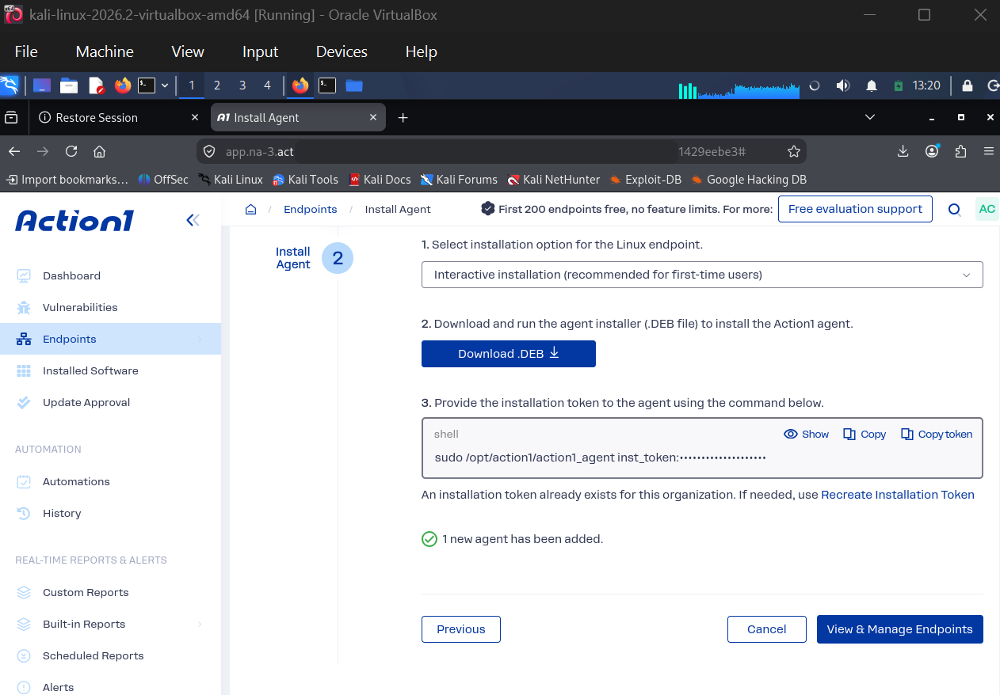

*Figure 15. Action1 Linux-agent wizard showing DEB installation instructions and successful agent-add confirmation; organization identifier redacted.. Source screenshot: `image145.png` from the original lab document.*

### 16. Confirm cross-platform enrollment

The endpoint inventory subsequently shows two connected systems:

| Endpoint | Operating system | Status shown |
| --- | --- | --- |
| `kali` | Kali GNU/Linux | **Connected** |
| `L3X` | Windows 11 (26H2) | **Connected** |

At the captured point, the Kali entry shows no available software or missing updates in its summary. That is an **Action1 inventory observation**, not proof that the Linux operating system is globally free from vulnerabilities or that every Linux patch is current.

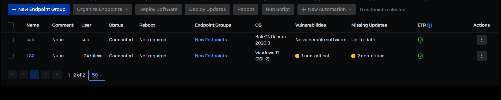

*Figure 16. Action1 inventory showing connected Kali Linux and Windows 11 endpoints.. Source screenshot: `image146.png` from the original lab document.*

### 17. Explore the managed software repository

Beyond patching, I used Action1's **Software Repository** to review deployable software. The screenshot shows built-in packages and **1Password** selected as a software deployment example.

**Why this matters:** Software distribution complements vulnerability management by helping administrators standardize required application versions and reduce uncontrolled manual installations.

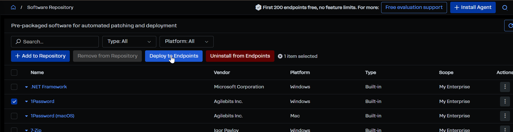

*Figure 17. Action1 software repository and selection of the 1Password package.. Source screenshot: `image147.png` from the original lab document.*

### 18. Configure a 1Password deployment

The software deployment wizard lists **1Password `8.12.44`** under **Deploy Software**. The wizard also exposes reboot options and the next step for choosing endpoints.

This shows that the application was selected and staged for a managed deployment. Software deployment should be planned with the same safeguards as patching: package source validation, user disruption, rollback planning and success checks.

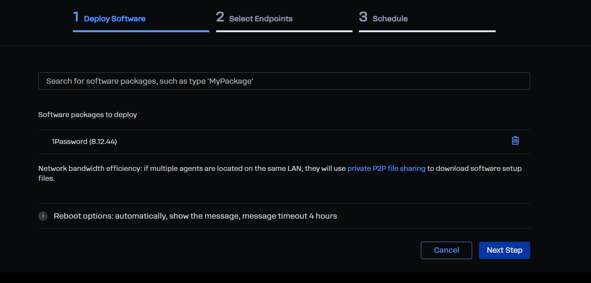

*Figure 18. Software deployment wizard with 1Password 8.12.44 selected.. Source screenshot: `image148.png` from the original lab document.*

### 19. Select the target endpoint

The **Select Endpoints** stage shows the connected Windows workstation `L3X` as the chosen target for the 1Password automation.

A target-selection screen proves that a deployment was **configured for the device**, not that installation completed.

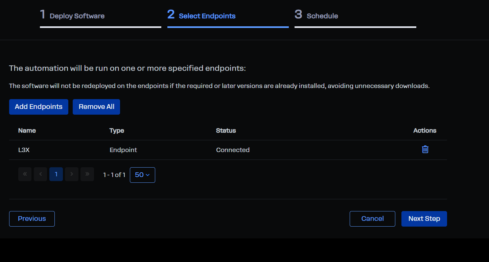

*Figure 19. 1Password deployment target selection for the connected Windows endpoint.. Source screenshot: `image149.png` from the original lab document.*

### 20. Track the software automation state

The Action1 automation details page subsequently shows **Deploy Software: 1Password 8.12.44** for `L3X` in the **Running** state. The details say the automation was waiting for the endpoint to run it.

**Evidence boundary:** Unlike the four-update patch automation in Step 7, this screenshot **does not show Success or Completed** for the 1Password deployment.

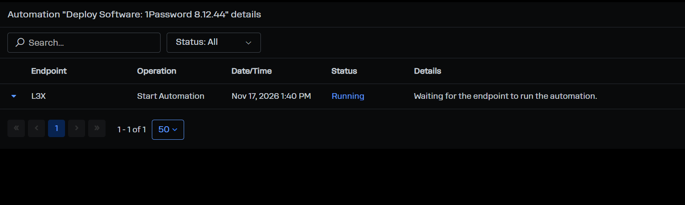

*Figure 20. Action1 1Password software deployment running; completion not visible in source evidence.. Source screenshot: `image150.png` from the original lab document.*

### 21. Inspect the Windows application view

The final screenshot shows **1Password** in the Windows **Recently added** area, alongside an unrelated system application.

This is corroborating evidence that the app was visible on Windows at capture time. It **does not prove by itself** that the Action1 deployment automation finished successfully; that attribution would require the corresponding successful automation history record or installer log.

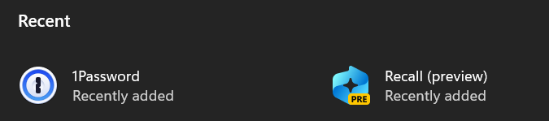

*Figure 21. Windows Recent view listing 1Password; contextual application evidence, not automation completion proof.. Source screenshot: `image151.png` from the original lab document.*

---

## Results and interpretation

| Test / workflow | Evidence-based outcome | Confidence / limitation |
| --- | --- | --- |
| Windows agent / inventory | `L3X` appears as Connected with Windows 11 26H2 metadata | Demonstrated in Action1 inventory |
| Critical update triage | Four Critical updates selected | Demonstrated by selected-update table |
| Critical update deployment | **Action1 reports Completed / Success** on Nov 16, 2026 | Job status confirmed; per-package logs not attached |
| Follow-up update review | A Critical filter with no entries, followed by non-critical backlog reviews | Dashboard snapshots; not a controlled longitudinal scan |
| Vulnerability exception triage | Compensating-control options displayed for findings without updates | UI workflow demonstrated; controls not verified as enforced |
| Linux endpoint enrollment | Kali appears Connected in endpoint inventory | Supported by installer/enrollment and inventory screenshots |
| 1Password distribution | Package/endpoint selected and automation started | Running status only; not a completed automation record |
| Windows 1Password visibility | App appears in Recently added | Installed-app evidence but causation not established |

### Lessons learned

- **Selection, execution and verification are three different stages.** Screenshots of a selected update or running automation must not be presented as completed remediation.
- **High severity should guide prioritization**, but update severity, vulnerability records and missing-update counts are different measures.
- **A successful automation record is stronger evidence** than a configured task; independent verification of package versions is stronger still.
- **Linux and Windows agents can be managed through one console**, although platform-specific package coverage varies.
- **Some findings require compensating controls** when an update is unavailable, unapproved or incompatible.
- **Software distribution has its own success criteria**, separate from vulnerability remediation.

## Recommended operational validation (not captured as completed tests)

For a production-quality patch audit, I would additionally:

1. Export a **before** vulnerability and missing-update inventory for the target machine.
2. Record the deployment automation identifier and time window.
3. Confirm each package's installed version after deployment, then reboot if required.
4. Export an **after** inventory with identical severity filters and a completed scan.
5. Confirm application launch or functionality (especially for business-critical software).
6. Recheck for failed updates, pending reboot, software conflicts, and recurring CVEs.
7. Close the change record with the affected endpoints, verification evidence, rollback or exception decisions, and sign-off.

For local Windows verification, an administrator could also use commands such as:

```powershell
# Examples for future verification; NOT commands documented as executed in this lab
Get-ComputerInfo | Select-Object WindowsProductName, WindowsVersion, OsBuildNumber
Get-HotFix | Sort-Object InstalledOn -Descending | Select-Object -First 10
```

`Get-HotFix` is primarily useful for Windows updates; it does not validate all third-party applications, such as Google Chrome or 1Password. Those require their own package/version checks or inventory exports.

## Remediation and hardening recommendations

| Priority | Recommendation | Rationale |
| --- | --- | --- |
| High | Patch critical browser and runtime updates promptly | Reduce exposure from known security issues reported by endpoint tooling |
| High | Validate patch deployment with refreshed inventory and application versions | Avoid treating configured jobs as completed remediation |
| High | Review unsupported or obsolete application versions | Reduce risks not adequately mitigated by routine patch distribution |
| Medium | Schedule non-critical updates by operational impact and exposure | Maintain reliability while reducing accumulated risk |
| Medium | Document compensating controls and exception expiry dates | Ensure unpatched findings remain visible and governed |
| Medium | Review maintenance windows, reboot policy and Windows Update control settings | Prevent unplanned service interruption or patch-policy conflicts |
| Medium | Secure Action1 administrative access and Linux enrollment tokens | Protect privileged remote-management capabilities |
| Medium | Monitor agent connectivity, failed automations and inventory staleness | Detect endpoints that silently fall out of management |

## Screenshot inventory
The full mapping from original source number to GitHub filename is in **[SCREENSHOT-GUIDE.md](SCREENSHOT-GUIDE.md)**. A small organization identifier was concealed in the Linux agent wizard image for safer public sharing; the enrollment token was already masked in the original capture.

## References

- [Action1 product and documentation](https://www.action1.com/)
- [Microsoft Windows update overview](https://learn.microsoft.com/en-us/windows/deployment/update/)
- [Debian APT package manager](https://wiki.debian.org/Apt)

---

**Alexander Cox** · [GitHub](https://github.com/KerberosAC) · [LinkedIn](https://www.linkedin.com/in/alexandercox25/)
